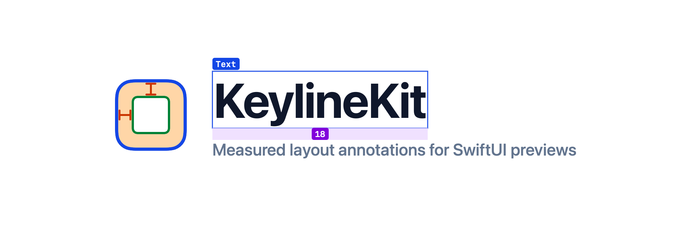
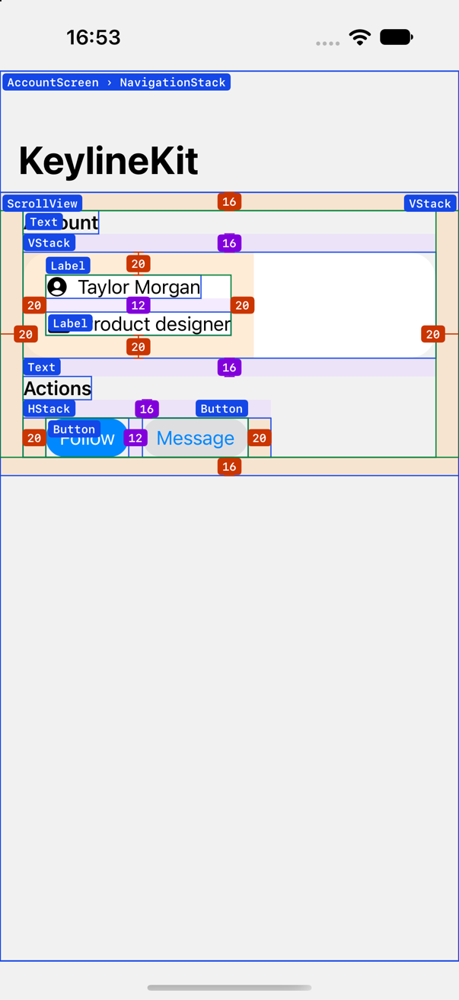
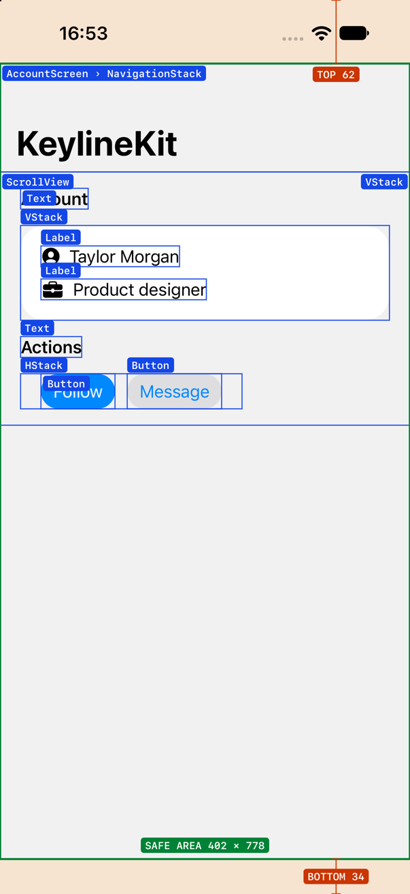
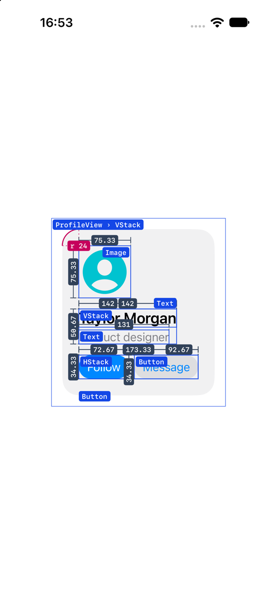
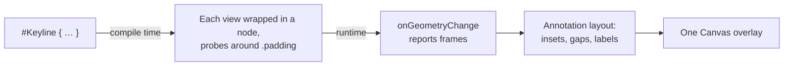

<picture>
  <source media="(prefers-color-scheme: dark)" srcset=".github/assets/keylinekit-banner-dark.png">
  
</picture>

<p align="center">
  <a href="#installation"></a>
  <a href="#installation"></a>
  <a href="#installation"></a>
  <a href="#license"></a>
</p>

# KeylineKit

**See the layout SwiftUI actually renders.**

Is that padding 16 or 20? Where does the safe area end? Why is there a gap
between those two rows? You usually find out by adding `.border(.red)`,
squinting at the Canvas and removing it again.

KeylineKit draws the answer on top of your preview. Wrap a view in
`#Keyline` and every layer gets its name, its padding and the spacing
between its siblings, **measured in points** from the rendered layout. It
can also show sizes, corner radii and the device safe area.

<p align="center">
  <a href="https://heliomartin.github.io/KeylineKit/"><picture>
    <source media="(prefers-color-scheme: dark)" srcset=".github/assets/keylinekit-website-dark.png">
    
  </picture></a>
</p>

<p align="center">
  <a href="#features">🌟 Features</a> ·
  <a href="#why-keylinekit">🤔 Why KeylineKit?</a> ·
  <a href="#installation">📲 Installation</a> ·
  <a href="#usage">🐒 Usage</a> ·
  <a href="#annotations">🎨 Annotations</a> ·
  <a href="#custom-views">🧩 Custom views</a> ·
  <a href="#how-it-works">⚙️ How it works</a> ·
  <a href="#contributing">❤️ Contributing</a>
</p>

<table>
  <tr>
    <td align="center" width="33%">
      <picture>
        <source media="(prefers-color-scheme: dark)" srcset=".github/assets/screenshots/default-dark.png">
        
      </picture>
      <br><sub><b>Layers, padding and spacing</b></sub>
    </td>
    <td align="center" width="33%">
      
      <br><sub><b>Safe area</b></sub>
    </td>
    <td align="center" width="33%">
      
      <br><sub><b>Corners and sizes</b></sub>
    </td>
  </tr>
</table>

<a name="features"></a>

## 🌟 Features

- 📏 **Measured, not guessed:** padding, spacing and sizes come from the rendered layout, in points.
- 🏷 **Every layer named:** each view's type next to its bounds, nested containers included.
- 📱 **Safe area at a glance:** device insets, the safe area and, on iOS 27.1, the reserved regions that cover content, such as camera housings.
- ⭕️ **Corner radii:** the arc and value of `cornerRadius:` and `.cornerRadius(_:)`.
- 🧩 **Your own views too:** `@Keylined` opens a custom view's `body` to the overlay.
- 🙈 **No label pile-ups:** all labels are laid out together, so they never cover each other.
- 🌗 **Light and dark:** a palette tuned for both.
- 🪶 **Preview-only:** `#Keyline` lives in your previews; your views render exactly as before everywhere else.

<a name="why-keylinekit"></a>

## 🤔 Why not just use `.border()`?

You can! A border or a background is often the quickest way to check one
view. KeylineKit is for when you want the whole picture, with numbers:

| You want to… | Usually | With KeylineKit |
| --- | --- | --- |
| 🔲 See a view's bounds | Add `.border(.red)` to each view, then remove it | Every layer is outlined and named |
| 📐 Check padding | Read the code and guess what `default` means | Each edge is measured: `16 · default` |
| ↕️ Check stack spacing | Add backgrounds or run the View Debugger | The gap between siblings is filled and measured |
| 📱 Check the safe area | Print `safeAreaInsets` | Insets and the safe area are drawn on the Canvas |
| ⚡️ Stay in Previews | The View Debugger needs a running app | Works in `#Preview`, no app launch needed |

<a name="installation"></a>

## 📲 Installation

Build with **Xcode 16 or later** (Swift 6). Your app can target
**iOS 16+, macOS 13+ or watchOS 9+**.

| Capability | Minimum |
| --- | --- |
| Layers, padding, spacing, sizes and corners | iOS 16 / macOS 13 / watchOS 9 |
| Safe-area insets | iOS 16 |
| Reserved regions that cover content | iOS 27.1 SDK and runtime |

In Xcode, choose **File › Add Package Dependencies…** and enter the
repository URL. Or add it to your `Package.swift`:

```swift
dependencies: [
    .package(url: "https://github.com/HelioMartin/KeylineKit.git", branch: "main"),
],
targets: [
    .target(name: "MyApp", dependencies: [
        .product(name: "KeylineKit", package: "KeylineKit"),
    ]),
]
```

KeylineKit depends only on [swift-syntax](https://github.com/swiftlang/swift-syntax)
(`600.0.0..<700.0.0`), which its macros need.

<a name="usage"></a>

## 🐒 Usage

Three steps:

### 1️⃣ Import

```swift
import KeylineKit
```

### 2️⃣ Wrap your preview

```swift
#Preview {
    #Keyline {
        VStack(spacing: 16) {
            ProfileView()
        }
        .padding(24)
    }
}
```

### 3️⃣ Read the Canvas

Every layer gets its name and outline. Padding appears as orange bands with
a value on each edge, and the gaps between stack children appear in purple.

That's it! There is nothing to remove before shipping: `#Keyline` only
runs where you write it.

> 💡 Values are measured, so they show what SwiftUI applies. When the
> source says something different, the declared value is shown next to it:
> `.padding()` reads `16 · default`, and `VStack(spacing: Theme.spacing)`
> reads `12 · Theme.spacing`.

<a name="annotations"></a>

## 🎨 Choose your annotations

With no arguments you get `.layers`, `.padding` and `.spacing`. Pass the ones
you want instead:

```swift
#Keyline(.padding, .corners) { ProfileView() }
#Keyline(.safeArea, .layers) { AccountScreen() }
#Keyline(.layers, showContainerLines: false) { ProfileView() }
```

| Annotation | Draws | Color |
| --- | --- | --- |
| `.layers` | The name of each layer next to its bounds |  |
| `.padding` | A band per `.padding(...)` call, a value per edge and the content outline |   |
| `.spacing` | The gap between siblings of a `VStack` or `HStack` |  |
| `.size` | Width and height dimension lines for each layer |  |
| `.corners` | The arc and value of each corner radius |  |
| `.safeArea` | Device insets, the safe area and reserved regions |    |
| `.none` | Nothing; outlines still follow `showContainerLines` | |

Layer outlines are on by default. Turn them off with `showContainerLines: false`.

<a name="custom-views"></a>

## 🧩 Look inside your own views

`#Keyline` only sees the code inside its own closure, so a custom view like
`ProfileView()` shows up as a single layer. Add `@Keylined` to the type and
the overlay also draws what its `body` declares:

```swift
@Keylined
struct ProfileView: View {
    var body: some View {
        VStack(alignment: .leading, spacing: 16) {
            Image(systemName: "person.crop.circle.fill")
            Text("Taylor Morgan")
        }
        .padding(24)
    }
}
```

When a view and the root of its `body` share the same frame, they share a
label: `ProfileView › VStack`.

<details>
<summary>🔍 What does the macro instrument?</summary>

- Any capitalized initializer (`VStack`, `ScrollView`, `NavigationStack`,
  `CustomCard`…) is entered, including closures such as `label:`,
  `header:` and `footer:`.
- The branches of `if`, `switch` and `#if` are entered.
- `ForEach` and `Group` without modifiers are transparent: their children
  count as siblings of the enclosing stack.
- Closures that are actions or don't build views are left alone:
  `Button("Save") { save() }`, `TextField`, `Canvas`, `Chart`, `Map` and
  `Table`. `Button(action:) { … }` and `Button { … } label: { … }` still
  instrument their label.
- Literals that Xcode rewrites for live editing (`__designTimeInteger(…)`)
  are shown with their value.

</details>

<details>
<summary>⚠️ Current limitations</summary>

- `.corners` reads the radius from modifiers, not from a root shape such as
  `RoundedRectangle(cornerRadius:)` used directly as a view.
- A custom view with modifiers (`ProfileView().padding()`) is drawn as a
  single layer, even when it uses `@Keylined`.
- Reserved regions need the iOS 27.1 SDK at build time and iOS 27.1 at runtime.

</details>

<a name="how-it-works"></a>

## ⚙️ How it works



1. **Macro** (`Sources/KeylineKitMacros`): rewrites the closure at compile
   time, wrapping each view and inserting probes before and after every
   `.padding(...)` and after every modifier with a corner radius.
2. **Measurement** (`Sources/KeylineKit/Measurement`): each node and probe
   reports its global frame with `onGeometryChange`. This also works inside
   `NavigationStack` and `ScrollView`.
3. **Drawing** (`Sources/KeylineKit/Rendering`): a pure, tested layout step
   turns the frames into regions, dimension lines and non-overlapping labels,
   and a single `Canvas` draws them.

Types prefixed with `_` are public only because the expanded code uses them;
they are hidden from the documentation.

### 📱 Try the demo

`Examples/KeylineDemo/KeylineDemo.xcodeproj` has a `#Preview` for each
annotation. The iOS app can also show the annotated screens at runtime:

```sh
xcrun simctl launch booted com.keylinekit.demo.ios -KeylineOverlay safeArea
```

Modes: `defaults`, `safeArea` and `details`.

<a name="contributing"></a>

## ❤️ Contributing

Found a layout KeylineKit draws wrong? I'd love to see it.

- Open an issue with a small view that reproduces it.
- Suggest an improvement or send a pull request.
- Add a test for a fix: macro expansions live in `Tests/KeylineKitMacrosTests`
  and layout logic in `Tests/KeylineKitTests`.

Run the tests with:

```sh
swift test
```

> 📣 If `xcode-select` points to the Command Line Tools, SwiftPM can't find
> the SDK's SwiftUI macros (`@State`, `@Entry`). Use Xcode's toolchain:
> `DEVELOPER_DIR=/Applications/Xcode.app/Contents/Developer swift test`.

## 👨🏻‍💻 Author

Made by [Helio Martín](https://github.com/HelioMartin).

<a name="license"></a>

## 👮🏻 License

KeylineKit is available under the [MIT license](LICENSE).
